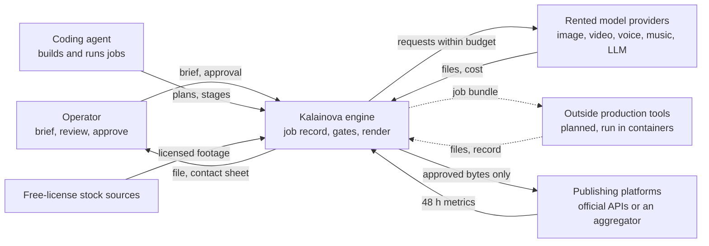
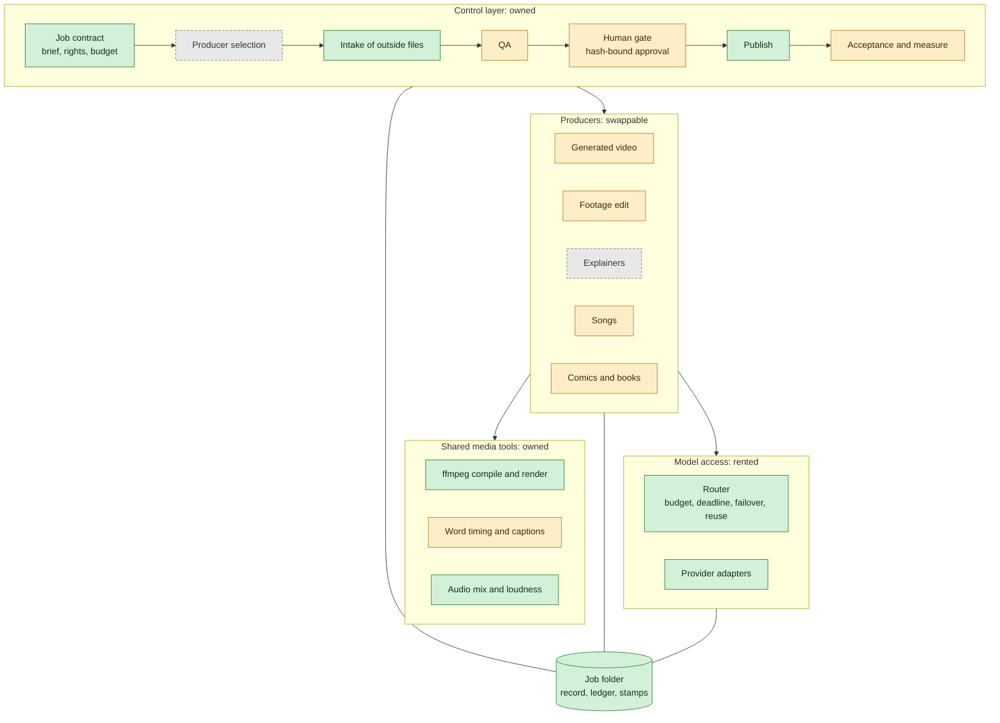
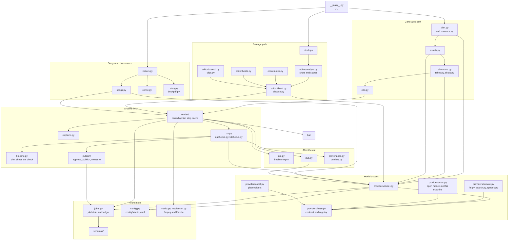
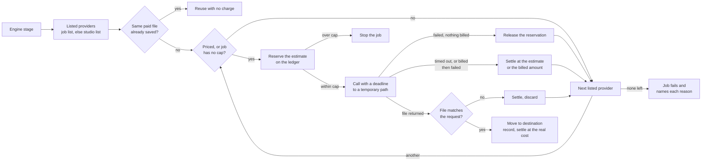
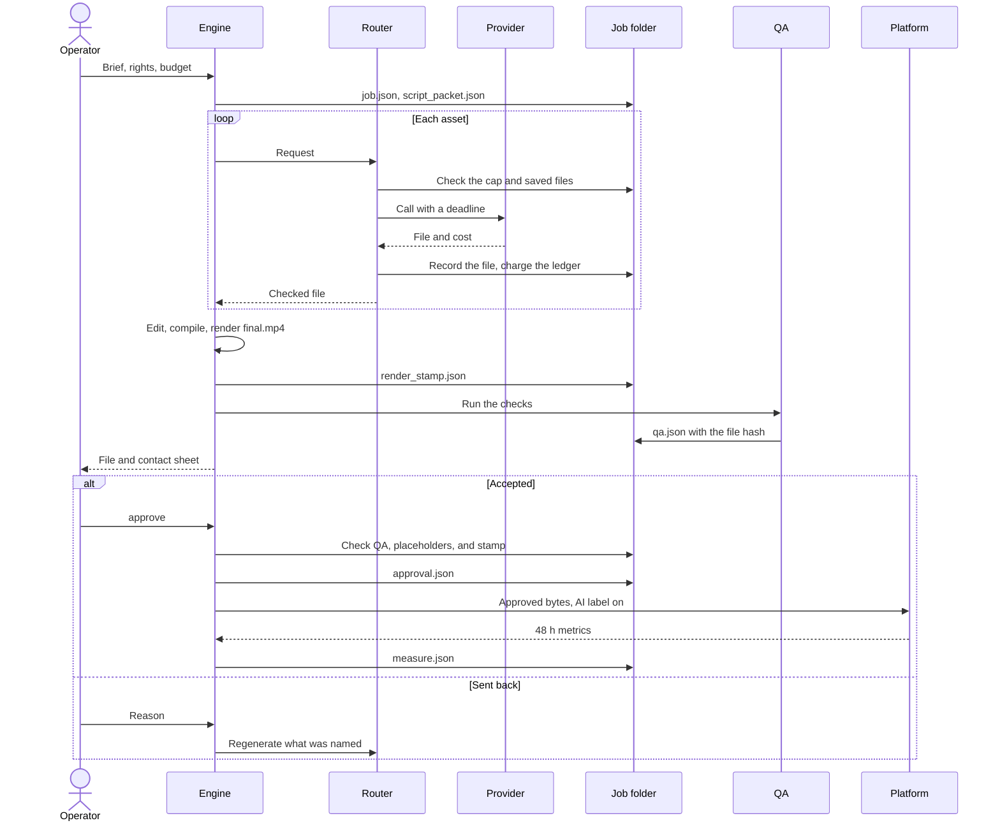
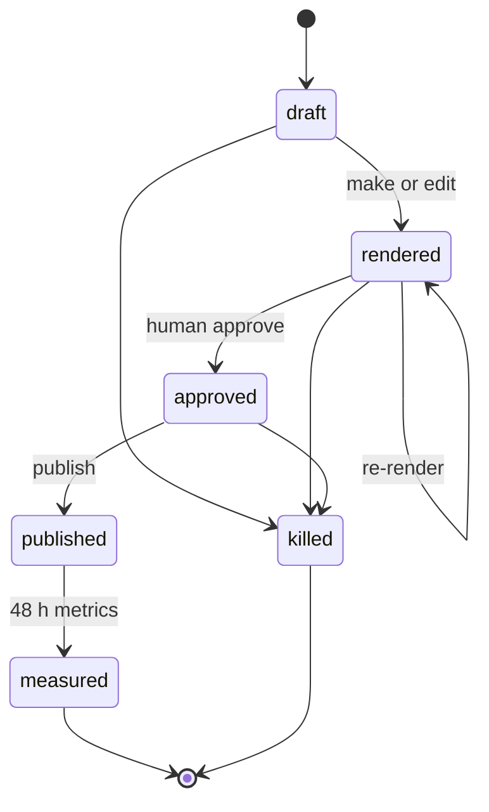
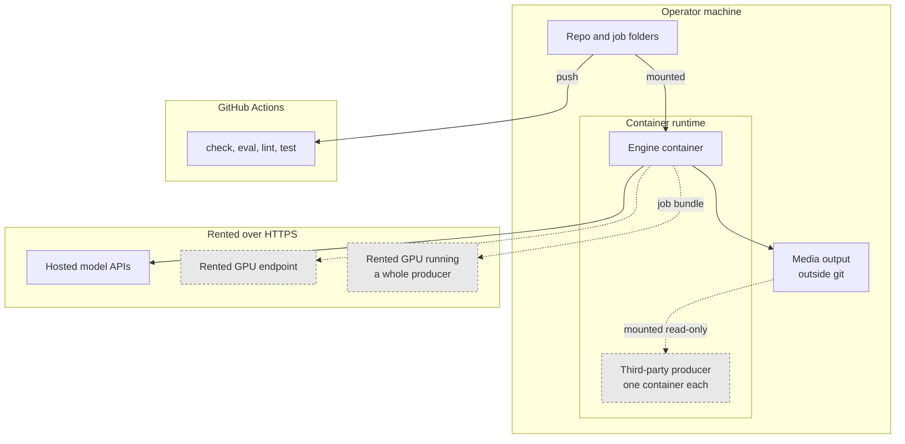
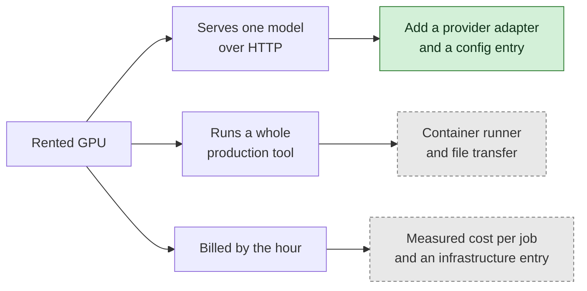
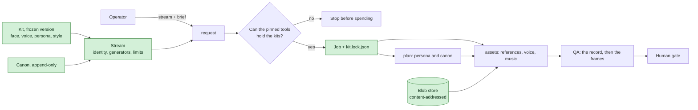
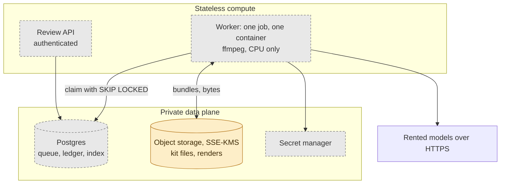

# Kalainova Architecture

Kalainova is one engine and many jobs. A job declares a **strategy** and one or more **media** kinds. It does not declare a segment. The engine owns the job record, the gates, and the measure of acceptance. It rents the models, and it can run outside production tools behind one contract.

In the diagrams, green is built, amber is partly built, and grey is planned. A planned part is a decision, not a claim that it exists.

## Executive Summary

One public engine and many private jobs. Rented models make the bytes; the engine owns the record, the gates, and the compile path. Two decisions shape the rest: a human approves every piece against its exact bytes (ADR 0007), and anything that must stay the same lives in a frozen kit that every model call must carry (ADR 0009).

## System Overview

The system context below is the runtime view.

## System context

Who and what the engine touches.



An agent never writes an approval (ADR 0007). A human approves every piece.

## Layer view

Dependencies point down. A lower layer never imports an upper one, and a producer or model can be replaced without changing the control layer.



## Component view: the engine today

The modules in `src/kalainova/`, and the two paths that make a piece. Every model call goes through `providers/router.py`.



## Component view: model access

What happens on one model call. The engine depends on the contract, never on a vendor.



A bug in an adapter is raised and does not count as a provider failure. Only listed providers are tried. `local` is listed in `config/studio.yaml`, so a run with no keys still works, and `approve` refuses what it makes.

`providers/check.py` is not on that path. `kalainova providers --check --spend` calls it by hand: it sends one smallest call per capability through `router.generate` under a job's cost cap, so the ledger records it, and reports reached, schema matched, and charge against estimate. It refuses under automation and never runs in CI or the tests.

## Sequence: one piece



## Job states



`scripts/check.py` also allows `rented` and `accepted`, for work finished in a rented tool.

## Deployment view

The engine runs on one machine. Anything from a third party runs in a container that sees only the folders mounted into it.



## Adding a rented GPU

Three different shapes, with different costs. None of them changes a stage of the engine.



## The stable interfaces

These change only with a version bump. A new interface waits for a second real use, so storage and queues stay plain for now.

| Interface | In | Out | State |
|---|---|---|---|
| **Provider** | Request, deadline, and budget, through the router | File, cost, model, provenance | Built, including songs, lip sync, stem separation, graphics, and search. Each adapter is tested against a faked vendor, not a live one. Requests are not typed. |
| **Producer** | Job bundle in a mounted folder | Files and a record, through `kalainova intake` | Partial. Intake is built. Tools run by a coding agent still need a container wrapper, and their output varies between runs. |
| **QA check** | Any file and its format | Pass or fail, with evidence | Partial. Files the engine did not render get technical checks only, and checks are not plug-ins yet. |

## Standing rules

- **No implicit fallback.** Only listed providers are tried.
- **No unpriced spending.** A job with a cap refuses a call it cannot estimate.
- **Every paid result is saved at once.** A restart reuses it.
- **Approval binds four things:** the bytes QA checked, the master they came with, the asset record they were rendered from, and a human reviewer.
- **A promise of motion is kept or refused.** A shot that asked to move does not quietly become a still (ADR 0013).
- **A fact states its source.** A finding reaches a script only when its quote is found in a saved copy of its source (ADR 0015).
- **A tool's own report is not proof.** Outside tools get their own API keys, so their costs can be checked against vendor invoices.
- **A model library is an implementation, not the interface.** It stays behind the provider contract with its own retries off or counted.

## Known gaps

| Gap | Effect |
|---|---|
| No publisher takes audio-only files | A song can be approved but not posted |
| No content review on files from outside tools | A human is the only check on their content |
| Nothing added since ADR 0012 has run on a real model | Every line of `docs/studio-goal.md` is Built, none is Run or Accepted. Faked models prove the wiring, not the result |
| Vendor slugs marked `VERIFY` in `config/studio.yaml` are unconfirmed | An adapter may need its model name or a field changed on its first real call |
| No container runner for outside tools | The contract exists, and nothing uses it in production yet |
| The ledger's lock holds on one machine | Parallel calls cannot overshoot here, but two machines could, until Postgres holds the ledger (ADR 0010) |
| Files from outside tools carry no enforced references | A human compares them against the kit |
| A kit cannot prove a face is not a real person's | A human attests at freeze and approves each piece; the vision judge is one more signal |
| Rendered files and job records are on one machine | Only kit files can reach object storage today (ADR 0010) |
| QA does not predict the operator's verdict | A file can pass QA and the bar and still be rejected on review. The bar measures craft defects, not taste |
| A printed book has no ligatures | Reading is unaffected, and the page images and the PDF measure the same widths. "fi" and "Th" print as separate letters |
| No publisher takes a comic or a book | They can be approved but not posted |
| Stereo only | No 5.1 or 7.1 mix, and an upmix from stereo is not an honest substitute |
| SDR only | No HDR master |

## Kits, streams, and jobs

Three objects carry continuity. The kit says what is fixed, and the stream says where it goes. The job locks exact versions, so a later kit change never moves a piece already made.



## Cloud path

Today one machine runs the engine, with kit files optionally in private object storage. Phases 2 and 3 are proposed in ADR 0010, and none of it is built.



## Component Diagram

Static view of top-level modules, an arrow wherever one imports another. `just ci-arch` checks that every component has a box here.

```
 __main__ ──▶ studio_cli ──▶ streams ──▶ consistency ──▶ kits ──▶ blobstore
    │            └─▶ lookdev ─▶ kits, kitrules, timeline, providers
    │                                       │  │          │
    │                                       │  └─▶ kitrules ◀── scripts/check.py
    │                                       └─▶ providers
    ├─▶ production_cli ──▶ dub, nle, provenance, qa, research, shotmake, shots,
    │                      songs, takes, timeline, verdicts, editor, config, bench,
    │                      assets, preproduction
    ├─▶ plan ──────▶ consistency, prompts, providers, shots
    ├─▶ research ──▶ plan, prompts, providers, config
    ├─▶ writers ───▶ consistency, plan, prompts, providers
    ├─▶ songs ─────▶ bar, captions, config, editor, media, providers, render, takes, writers
    ├─▶ assets ────▶ consistency, media, preproduction, shotmake, shots, soundbed, takes,
    │                config, providers
    ├─▶ preproduction ▶ media, motion, shotmake, takes, timeline, providers
    ├─▶ soundbed ──▶ blobstore, kits, media, shotmake
    ├─▶ shotmake ──▶ blobstore, consistency, media, shots, takes, config, providers
    ├─▶ takes ─────▶ bar, blobstore, media, config
    ├─▶ bench ─────▶ consistency, shotmake, shots, takes, timeline, config, providers
    ├─▶ shots ─────▶ config
    ├─▶ edit ──────▶ config
    ├─▶ render ────▶ bar, captions, look, motion, media, mediascan
    ├─▶ qa ────────▶ bar, comic, story, songs, research, timeline, qachecks, plan, prompts,
    │                media, stock, config, providers, publish
    ├─▶ qachecks ──▶ bar, consistency, kitchecks, plan, prompts, shots, timeline, config,
    │                providers, publish
    ├─▶ kitchecks ─▶ consistency, kits
    ├─▶ timeline ──▶ bar, captions, media
    ├─▶ bar ───────▶ media, mediascan, editor, config
    ├─▶ mediascan ─▶ media
    ├─▶ comic ─────▶ captions, consistency, render, shotmake, providers
    ├─▶ story ─────▶ bookpdf, comic, captions, render, providers
    ├─▶ bookpdf: fonts and PDF drawing, no engine imports
    ├─▶ dub ───────▶ captions, media, plan, prompts, render, config, providers
    ├─▶ nle: the cut as timeline files, from the job folder alone
    ├─▶ provenance ▶ blobstore, takes, verdicts, config
    ├─▶ verdicts ──▶ bar, media, jobfs
    ├─▶ publish ───▶ blobstore, consistency, preproduction, streams, stock
    ├─▶ editor ────▶ edit, media, plan, prompts, stock, config, providers
    ├─▶ intake ────▶ media, render
    ├─▶ stock
    ├─▶ prompts, captions, look, motion, media: imported throughout, and import no stage
    └─▶ jobfs, config: the foundation, imported throughout
```

## Components

### __main__
The command line. Parses arguments and calls a stage. Holds no rules.

### studio_cli
Commands for kits, streams, canon, schedules, requests, and the look sheet.

### production_cli
Commands for making and judging a piece shot by shot, songs, research, and everything after a cut: takes, retakes, the shot sheet, timeline export, clips, dubbing, verdicts, provenance, and the ledger.

### kitrules
What makes a kit legal. Stdlib only, shared by the engine and `scripts/check.py`.

### kits
Kit lifecycle: draft, add a file, freeze, bump, load, and verify stored bytes.

### blobstore
Local cache plus optional S3-compatible durable copy, addressed by hash.

### streams
Stream records, canon, the schedule packet, and `request`, which turns a stream and a brief into a locked job.

### consistency
Resolves a stream's kits, builds and verifies the lock, applies the fixed things to each shot and script, and holds `RULES`, the table of how each is enforced.

### prompts
Loads versioned prompts from `prompts/`.

### plan
Intent to script. Loads the kits' persona and canon for a stream job, and only verified findings for a job with research.

### research
Sources, a private saved copy of each, and findings whose quotes are checked against those copies. A model can suggest a fact, and only a found quote lets it into a script (ADR 0015).

### writers
A brief to the script a song, a comic, or a book is made from, each held to its own schema.

### shots
What a shot says, kept apart: the still prompt, the motion prompt, continuity shared across shots, and a review of the plan before any money is spent.

### takes
Attempts at one shot, each with its own seed and readings. A reading picks among them, and a person's choice stands (ADR 0013).

### bench
A camera test: one shot made on several models from the same start frame, prompt, and seeds. It prints each model's estimate, refuses before any call when the total passes the job's cap, and makes takes marked `bench` through the router and the take store, so each carries its model, seed, and cost. It writes one sheet with a row per take. Depends on `consistency`, `shotmake`, `shots`, `takes`, `timeline`, `config`, and `providers`.

```
 shot + models --> estimate per model --> over the cap? --> refuse, no call
                                              | no
                                              v
        router --> takes.attempt (bench) --> takes.json --> timeline.bench_sheet
```

### shotmake
One shot from start to finish: where it starts, its takes, a retake, its lip sync, and the sound of its place. A first run and a retake share this code, so they keep the same promise and the same record. A retake is refused past the take limits (`takes.check_retake`), and with no note it reads that shot's finding from `findings.json`.

### preproduction
The rough cut before the money, and the gate on it. The assets stage, run with `animatic`, makes the voice and one still per shot and asks for no video. This module prices each moving shot (`moving_quotes`, per shot, at the length asked for), draws the stills under a camera move with the words and the voice into `animatic.mp4` stamped ANIMATIC, and writes `animatic.json`. `require_review` is the gate: with `brief.animatic_gate` set, the assets stage refuses before any spend unless the job's `animatic_reviewed` is an `accept` for the cut that exists now. `publish` refuses an animatic by name and by hash. Depends on `media`, `motion`, `shotmake`, `takes`, `timeline`, and `providers`.

```
 assets(animatic) ─▶ voice + stills ─▶ made{timeline, shots, quotes}
                                           │
        preproduction.render ──▶ animatic.mp4        preproduction.write_record ──▶ animatic.json
                                                                   │
 verdict --animatic ──▶ job.animatic_reviewed ◀── sha of the cut ──┘
                              │
 assets(full) ─▶ require_review ─▶ refuses, or goes on to pay for video
```

### lookdev
Look development: a sheet of a kit's candidate references, each at three framings (crops of what was given), and optionally one test still per look through the router, under a cap, on a model that takes references. It reads a kit's draft or latest frozen version and changes no kit. A person picks, and a person freezes. Depends on `kits`, `kitrules`, `timeline`, and `providers`.

### assets
Script to files. Every shot of a stream job carries its references and pinned model.

### soundbed
The sound under a piece: a kit's fixed file, a finished track from another job, or a bed made for it.

### edit
Assets to an edit manifest.

### render
Edit manifest to a closed op list, then to the file through ffmpeg. A plan can be written by a model, so `spec` checks every argument and path first. `cache` keeps a step whose inputs and settings have not changed, so changing one shot re-encodes only what it touches.

Kinetic captions (`brief.captions: kinetic`) take a different route inside `burn_captions`: `drawn` writes a transparent HyperFrames page from the same word timings, renders it alone to a WebM with alpha, and lays it over the graded picture with ffmpeg, so the grade path is untouched. The page keeps its type inside the profile's `safe_zone`, and the boxes it placed go to `captions.drawn.json` for the QA warning. `drawn` also writes the title, quote and stat card compositions (`kalainova card`). Film profiles never reach it: they burn nothing.

The export step picks the cover (`cover`): the sharpest clean frame across the piece, clear of the fades, or the time or file a brief names, plus a square cut around the most detailed part.

Picture steps hand each other lossless 10-bit masters, so nothing degrades between steps. The cost is hundreds of megabits a second, gigabytes for a short piece. The title pass is skipped when there is nothing to burn in, rather than writing a second copy. `cache.clean` (`kalainova clean`) deletes the picture intermediates a plan wrote, and nothing else: the final, assets, takes, and sound stems stay, and the next render remakes what was deleted.

```
edit_manifest ─▶ compile_plan ─▶ render_plan.json ─▶ execute
                                                       │  for each step:
                                                       │  spec.coerce ─▶ cache.unchanged? ─▶ keep
                                                       ▼                        │ no
             picture: still, cut, scale, concat, titles, captions ◀─────────────┤
             sound:   voice, music, places, effects, loudness     ◀─────────────┤
             export:  web file, master, thumbnail                 ◀─────────────┘
```

### songs
Lyrics to takes of a song, readings that pick among them, a master, lyric files, release files for a distributor (`render/release.py`: WAV, FLAC and MP3 with tags, cover and lyrics), optional stems through a `separate` provider, a refusal before spending when a song asks for more than the model states it can make (`router.refuse_too_long`), and a job that cuts a video to the finished track (ADR 0014).

### dub
A piece in another language as a job of its own: its music and effects stem under new voices, and captions in the new language, with its own human gate.

### nle
The cut as files an editing system opens: FCPXML, OpenTimelineIO, and EDL.

### timeline
Looking at a piece without playing it: the first and last frame of every shot, a motion strip of frames across each shot, a cut strip of frames either side of each join, a filmstrip over a waveform, and a check for a click or a flash at each cut.

### captions
Word timings to captions, title and caption layout by frame shape and real font metrics, and timed-text files. Fonts are vendored in `fonts/`.

### look
The grade as data: one 3D LUT path for stills and footage, with skin protected and blacks never crushed. Pure.

### motion
The camera on a still: sub-pixel sampling at one steady rate. Frames go to ffmpeg as 16-bit RGB.

### comic
A comic script to pages, a print PDF, a CBZ, and a phone scroll. Models never letter: art is generated with no words, and the engine lays out each page, places balloons where the art is calm, and letters them. Kit references travel with every panel.

### story
A story to a typeset book and a real EPUB with live text. Pages are laid out once, then drawn twice: as images to review, and as type to print.

### bookpdf
A book's pages as a PDF with live text in embedded fonts, at the same places as its page images. The same input gives the same bytes, because approval binds to them.

### bar
The studio bar: what "finished" means, as numbers a tool computes. Pure signals over pixels (`picture`), motion (`motion`), and samples (`sound`), plus the readers that apply them to a file, a job's sources (`sources`), a delivery master (`master`), or a song (`song`). Limits live in `config/studio.yaml`. It reports conformance and craft apart, because a single total flatters whatever the renderer makes. It informs the human gate, and only an objective defect blocks.

### qa
Runs the automated checks before the human gate, for a rendered piece, a document, a song, or a file from an outside tool.

### qachecks
The checks QA runs that each ask one question: a kept promise of motion, a model's licence, the layers of a mix, the plan, the cuts, what a vision judge saw (it is sent the shot sheet and the motion strip, and its faults are kept as findings), and burned text or a face outside a profile's safe zone.

### kitchecks
What QA asks of a stream job: did the record keep what the lock promised, and do the frames match the kit's references.

### verdicts
What a person said about a piece or one shot, or about the animatic as a rough cut, and which readings predict it. A verdict on the animatic sets the job's `animatic_reviewed` and is left out of the review set. `review-set` lists each verdict beside its readings, including a shot's own source clip, and says "not enough yet" below three of each side. It reads the bar's `generated_shot_motion` and cannot approve or publish anything.

### provenance
How a piece was made, for whoever answers for it: each asset's model, weights, seed, terms, and hash.

### publish
Approve, publish, and measure. Binds approval to the bytes and a stream piece to its own account. `labels` sets each platform's AI-content label from the assets' synthetic flag, using the fields the aggregator documents, and refuses a platform with none; it also holds a publish time only where the platform's own API takes one. `aggregator` is the one-upload route to several platforms.

### providers
The router and vendor adapters. Every model call goes through the router, which reserves the estimate before the call, settles at the real cost after it, and refuses a file that is not what was asked for or has no picture in it. `fal` and `remote` rent models over HTTPS, `spaces` rents free hosted ones, `search` finds sources, and `hyperframes` renders a composition as a shot. `mac` runs open models on a Mac's GPU (`docs/how-to/run-models-on-a-mac.md`); `runners/` holds what runs in the models' own environment, and the engine never imports it.

### editor
The footage path: shots, scores, direction, and notes. `choose` holds the pure decisions: which take, in what order, at what length. `speech` cuts on words when a transcript exists, and `clips` finds short pieces in a long recording.

### stock
Free-license footage with credits.

### intake
Takes a finished file from an outside tool.

### media
ffmpeg and ffprobe helpers. Commands are argument lists, never shell strings.

### mediascan
Reading a whole file: where its picture sits, its frames one at a time, and how it bands.

### jobfs
The job folder, schema validation, the ledger, and the private home.

### config
The model and price table.

## Cockpit

```
just ci ──► ci-contract  check.py, --fixtures   no media blobs; jobs, kits, streams match the contract
        ──► ci-lint      ruff, mypy, import rules, gitleaks, opengrep
        ──► ci-test      pytest with a coverage floor, including one full render
        ──► ci-docs      lint_docs.py            engine docs grow no worked example
        ──► ci-arch      every component has a section and a box
```

| Plane | Where | Role |
|---|---|---|
| Strategies | `docs/strategies.md` | How a piece gets made and how it can get paid. Subject-agnostic. |
| Pipeline | "Sequence: one piece" above | Stages from brief to measure. Same spine for every medium. |
| Contract | `schemas/` | Job, script, assets, edit, render plan, QA, approval, publish log, measure. |
| Jobs, kits, streams | `$KALAINOVA_HOME` | Operator data, in a private directory. This repo is public (ADR 0010). |
| Gates | `scripts/check.py`, `scripts/lint_docs.py`, pre-commit, `.github/workflows/ci.yaml` | Media stays out of git. Jobs that violate the contract fail. Engine docs stay subject-free. |
| Decisions | `docs/decisions/` | One ADR per standing rule. |
| Evals | `evals/contract/` | Contract fixtures run now. The content eval waits for an accepted or measured job. |

Rent the models. Own the job folder, the gates, and the compile path (ADR 0007). A schema is not a shipped frame.
