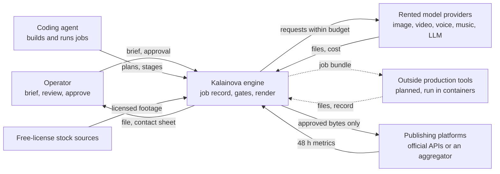
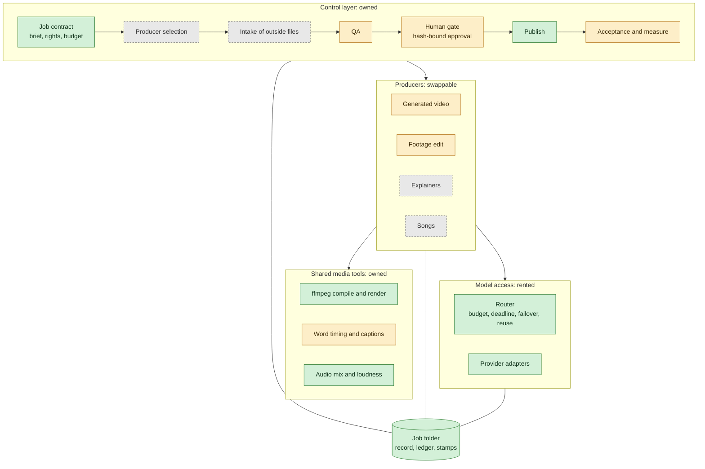
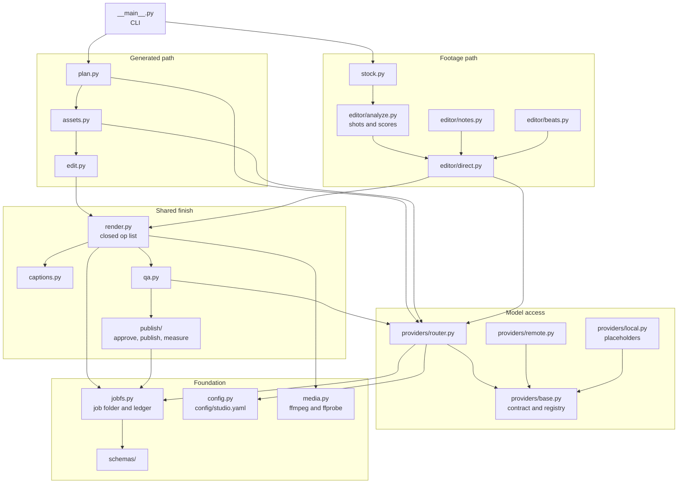
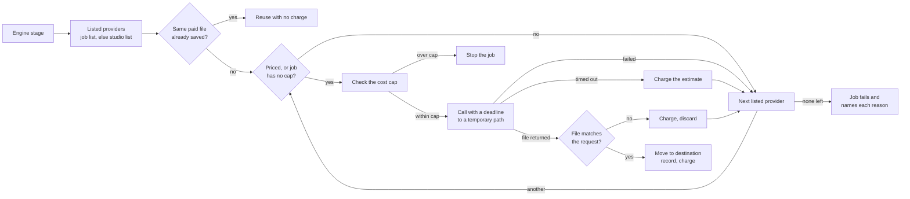
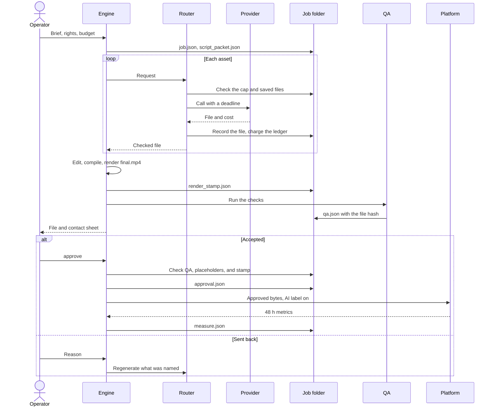
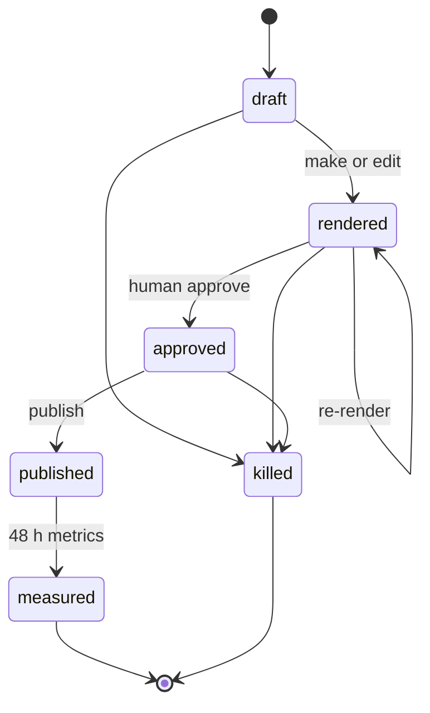
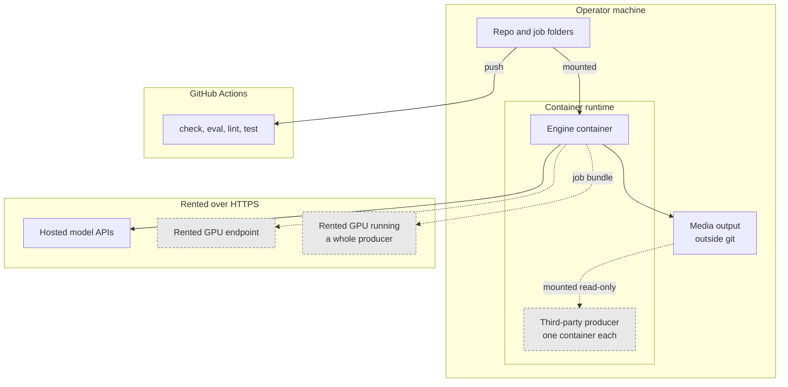
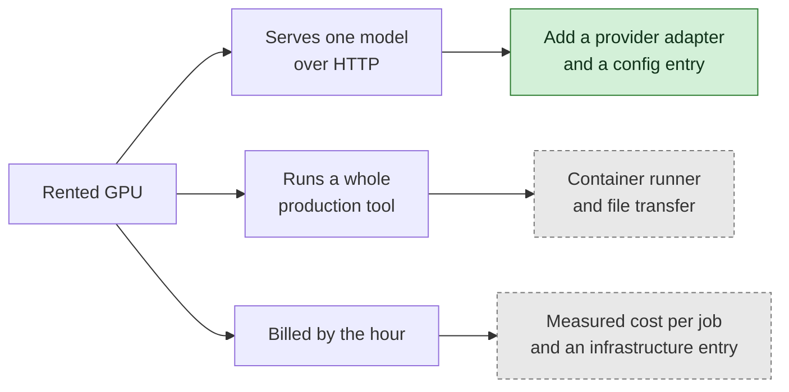

# Architecture

Kalainova is one engine and many jobs. A job declares a **strategy** and one or more **media** kinds. It does not declare a segment. The engine owns the job record, the gates, and the measure of acceptance. It rents the models, and it can run outside production tools behind one contract.

In the diagrams, green is built, amber is partly built, and grey is planned. A planned part is a decision, not a claim that it exists.

## System context

Who and what the engine touches.



An agent never writes an approval (ADR 0007). A human approves every piece.

## Layer view

Dependencies point down. A lower layer never imports an upper one, and a producer or model can be replaced without changing the control layer.



## Component view: the engine today

The modules in `kalainova/`, and the two paths that make a piece. Every model call goes through `providers/router.py`.



## Component view: model access

What happens on one model call. The engine depends on the contract, never on a vendor.



A bug in an adapter is raised and does not count as a provider failure. Only listed providers are tried. `local` is listed in `config/studio.yaml`, so a run with no keys still works, and `approve` refuses what it makes.

## Sequence: one piece



## Job states



`scripts/check.py` also allows `rented` and `accepted`, for work finished in a rented tool.

## Deployment view

The engine runs on one machine. Anything from a third party runs in a container that sees only the folders mounted into it.



## Adding a rented GPU

Three different shapes, with different costs. None of them changes a stage of the engine.



## The stable interfaces

These change only with a version bump. A new interface waits for a second real use, so storage and queues stay plain for now.

| Interface | In | Out | State |
|---|---|---|---|
| **Provider** | Request, deadline, and budget, through the router | File, cost, model | Built. Requests are not typed yet, and a song request does not fit. |
| **Producer** | Job bundle in a mounted folder | Files and a record | Planned. Tools run by a coding agent need a container wrapper, and their output varies between runs. |
| **QA check** | Any file and its format | Pass or fail, with evidence | Planned. QA today requires the engine's own `edit_manifest.json`. |

## Standing rules

- **No implicit fallback.** Only listed providers are tried.
- **No unpriced spending.** A job with a cap refuses a call it cannot estimate.
- **Every paid result is saved at once.** A restart reuses it.
- **Approval binds three things:** the bytes QA checked, the asset record they were rendered from, and a human reviewer.
- **A tool's own report is not proof.** Outside tools get their own API keys, so their costs can be checked against vendor invoices.
- **A model library is an implementation, not the interface.** It stays behind the provider contract with its own retries off or counted.

## Known gaps

| Gap | Effect |
|---|---|
| Plug-in registered before the built-ins load | Built-in providers disappear |
| QA requires `edit_manifest.json` | An outside tool's file cannot be checked |
| Gate is built around `final.mp4` | An audio-only piece cannot be approved |
| Asset schema has no open provenance field | GPU node, weights hash, and seed cannot be recorded |
| `music()` takes no lyrics | Songs do not fit the provider contract |
| Cap checks run one call at a time | Parallel calls could overshoot the cap together |
| QA does not predict the operator's verdict | A file can pass QA and still be rejected on review |

## Cockpit

```
just ci ──► check   scripts/check.py           no media blobs in git; every job folder matches the contract
        ──► eval    check.py --fixtures        evals/contract: pass/ must pass, fail/ must fail
        ──► lint    scripts/lint_docs.py       engine docs grow no worked example
        ──► test    pytest                     engine tests, including one full render
```

| Plane | Where | Role |
|---|---|---|
| Strategies | `docs/strategies.md` | How a piece gets made and how it can get paid. Subject-agnostic. |
| Pipeline | `docs/pipeline.md` | Stages from intent to measure. Same spine for every medium. |
| Contract | `schemas/` | Job, script, assets, edit, render plan, QA, approval, publish log, measure. |
| Jobs | `jobs/<id>/` | One piece. Copy `jobs/_template`. Subject text stays in that folder only. |
| Gates | `scripts/check.py`, `scripts/lint_docs.py`, pre-commit, `.github/workflows/ci.yml` | Media stays out of git. Jobs that violate the contract fail. Engine docs stay subject-free. |
| Decisions | `docs/decisions/` | One ADR per standing rule. |
| Evals | `evals/contract/` | Contract fixtures run now. The content eval waits for an accepted or measured job. |

Rent the models. Own the job folder, the gates, and the compile path (ADR 0007). A schema is not a shipped frame.
