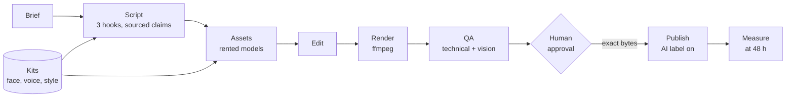

# Kalainova

**An AI production studio you run yourself. Turn a one-line brief into finished video, audio, stills, and text, keep the same characters across every piece, and publish only what a human approved.**

[](https://github.com/kaiverse-io/kalainova/actions/workflows/ci.yaml)
[](LICENSE)


Most AI video tools generate clips. Kalainova runs the production line around them: script, assets, edit, render, QA, approval, publishing, and measurement, with a record of every step. You rent the best models and swap them in a config file. You own the pipeline, the characters, and the log.

## Why Kalainova

| Problem with generated media | What Kalainova does |
|---|---|
| The same character has a different face in every shot | Frozen character kits. Every still and clip carries the reference images, and QA checks the result. |
| Models change every few weeks | Models are a config entry. Your characters are files you own, so they outlast any vendor. |
| Costs run away | A cost cap is reserved before every paid call, and each job keeps a ledger. |
| Unreviewed output reaches an audience | A human approves the exact bytes, by hash. Change a byte and the post is refused. |
| A model-written edit could do anything | The renderer runs a closed list of ffmpeg operations, with paths confined to the job. |
| One account's post goes to another | Each stream has one identity, and posts with that identity's own credentials. |

## How it works



Three objects carry the work:

- **Kit:** what stays the same. A face, looks, a voice, a persona, places, props, a visual style, or a music theme. Each version is frozen and hashed.
- **Stream:** where it goes. A channel, an account, or a series, with one identity, its kits, its generators, and its limits.
- **Job:** one piece, locked to exact kit versions, so later kit changes never alter it.

Ask for a piece on any stream, and the engine works out the rest:

```bash
kalainova request <stream> "<brief>" --cast <character>
```

If the pinned model can't accept reference images, the request stops before spending anything.

## Quick start

You need [uv](https://docs.astral.sh/uv/), [just](https://just.systems), and an `ffmpeg` with libass on your `PATH`. On macOS that is `brew install ffmpeg-full`, then put its `bin` on your `PATH`, because the plain formula has no libass.

```bash
git clone https://github.com/kaiverse-io/kalainova && cd kalainova
uv sync
uv run kalainova providers
```

With no API keys, placeholder providers still run the line end to end, and `approve` refuses what they make. Add keys for real output:

```bash
export ANTHROPIC_API_KEY=...   # script and vision QA
export FAL_KEY=...             # image and video
export ELEVENLABS_API_KEY=...  # voice, music, and effects
```

Keep your own work out of this repository by pointing the engine at a private directory:

```bash
export KALAINOVA_HOME=~/work/my-studio
```

Then follow **[How to run channels and characters](docs/how-to/run-a-stream.md)**, or make a one-off piece with **[How to open a job](docs/how-to/open-a-job.md)**.

## Capabilities

| Area | What's included |
|---|---|
| **Generation** | Voice with word timings, images, video, music, songs, effects, lip sync, stem separation, and rendered graphics, through provider adapters with a per-job provider list |
| **Direction** | First frame, last frame, and motion written apart; several takes of a shot, each with its own seed; a reading picks and a person overrides; one shot retaken alone; a shot that asked to move cannot quietly become a still |
| **Continuity** | Character, style, and sound kits; a job lockfile; an append-only story canon; per-shot reference selection |
| **Editing** | A lossless 10-bit picture path, a sub-pixel camera on stills, one grade path for stills and footage, type placed against the picture, sidechain-ducked music, true-peak mastering, and an editor for your own footage that takes revision notes |
| **Comics and stories** | Pages laid out and lettered by the engine with art that carries no words, print PDF, CBZ, and phone scroll; typeset books as a PDF with live, embedded type and a real EPUB |
| **Songs** | Lyrics to takes, readings that pick among them, a master, lyric files, and a video cut to the finished track |
| **Research** | Sources, a private saved copy of each, and findings that reach a script only when their quote is found in that copy |
| **Footage** | An editor that takes revision notes, speech cut on words instead of silences, closed captions from what was said, and short clips found in a long recording |
| **Delivery** | Web H.264, a ProRes 422 HQ master with LPCM stereo for film profiles, voice and music-and-effects stems, dubbing into another language, captions as SRT, WebVTT, and iTunes Timed Text files, and the cut as FCPXML, OpenTimelineIO, or EDL |
| **Quality gates** | Frame, duration, loudness, true peak, black frames, dead air, pacing, hook timing, caption coverage, claim sources, rights, disclosure, a vision judge, [the studio bar](docs/studio-bar.md): banding, judder, motion with the camera's move taken out, repetition, source marks, detail, clicks, voice-to-music, and delivery checks, with conformance and craft reported apart |
| **Publishing** | YouTube Data API and Upload-Post, with the synthetic-media label required |
| **Operations** | Cost reserved before each call and settled at the real amount, saved paid results that a restart reuses, a render that re-encodes only what changed, a chain of title for each piece, human verdicts checked against the readings, posting limits, dated schedules, and 48-hour measurement |

Models and prices live in [`config/studio.yaml`](config/studio.yaml).

## Status

Kalainova is pre-1.0. The line runs and is tested, but it hasn't yet proven itself on real output.

| Part | State |
|---|---|
| Pipeline, gates, approval binding | Built and tested with placeholder providers |
| Kits, streams, locks, schedules | Built and tested with stand-in providers |
| Takes, songs, research, dubbing, clips, timeline export | Built and tested with faked models. None has made a real piece yet. [The studio goal](docs/studio-goal.md) keeps the score |
| Live model and publishing adapters | Written from vendor docs; verify model IDs and fields before your first paid run |
| A piece accepted or measured in public | Not yet. This is the next milestone |
| Postgres, workers, and a review service | Designed in [ADR 0010](docs/decisions/0010-private-home-and-cloud-path.md), not built |

Reference-based character consistency relies on what the vendors claim for their models, so test it on your own character. Known limitations are listed in [ARCHITECTURE.md](ARCHITECTURE.md#known-gaps).

## Architecture

The engine is a single Python package that reads and writes JSON contracts, validated against [`schemas/`](schemas/). Today it runs on one machine, with optional S3-compatible storage for kit files. The planned cloud design adds a Postgres queue and stateless render workers. Rendering needs CPU and ffmpeg only, because the models are rented over HTTP.

- [ARCHITECTURE.md](ARCHITECTURE.md): system, component, and sequence views
- [docs/decisions/](docs/decisions/): why it's built this way
- [docs/studio.md](docs/studio.md): goals, model stack, and roadmap

## Responsible use

These rules are enforced by the engine, its contract checks, or project policy:

- **Humans approve every piece.** Publishing requires an approval from a named reviewer, bound to the exact file. Project policy forbids agents from giving it.
- **Characters are invented adults.** A kit with a face must declare this, attested by a named person. A real person's likeness is refused. No software can prove a face is not a real person's, so that check stays with the human who signs off.
- **Synthetic media is labelled,** or the post is refused.
- **Factual claims carry sources.** Fiction is marked as fiction.
- **Sexual content is out of scope.** The engine's writer prompts refuse it on every stream.
- **Source material needs rights.** Every job declares `owned`, `licensed`, or `funded-brief`.

## Security

- Secrets stay in your environment, never in a kit, stream, or job. Streams hold only account handles.
- Kit files are stored by hash, so a changed or tampered file is refused. S3 storage supports SSE-KMS encryption.
- CI runs secret scanning and semantic rules, and the render path never builds a shell command.
- Reference images are sent to the model vendors you configure, so check their retention terms.

Please report vulnerabilities through a private GitHub security advisory rather than a public issue.

## Contributing

```bash
just ci    # contract, lint, types, secrets, semantic rules, tests, docs, architecture
```

`just ci` also needs `gitleaks` and `opengrep` installed. Read [CONTRIBUTING.md](CONTRIBUTING.md) and [AGENTS.md](AGENTS.md) first. Engine docs stay subject-free: no sample topics, brands, or characters in this repository. Project scaffolding comes from [chassis](https://github.com/kaiverse-io/chassis).

## License

[Apache License 2.0](LICENSE). Copyright 2026 kaiverse-io.

Third-party notes are in [NOTICE.md](NOTICE.md).
